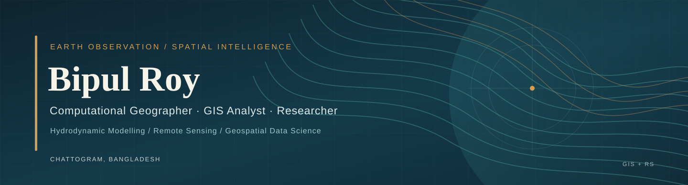

<!-- GitHub profile README | Bipul Roy | @Bipul-roy-AI -->

  

<h1 align="center">Bipul Roy</h1>

<strong>Computational Geographer · GIS Analyst · Geospatial Researcher</strong>

Hydrodynamic Modelling · Earth Observation · Spatial Epidemiology · Environmental Data Science

  
  
  
  

### Academic Portfolio

**[Visit my academic website →](https://bipul-roy-ai.github.io/)**

My updated, mobile-friendly academic portfolio is built with the [academic-website-template](https://github.com/sbryngelson/academic-website-template) and highlights my **research**, **professional experience**, **manuscripts and presentations**, and **open-source geospatial software**.

[Research](https://bipul-roy-ai.github.io/research/) · [Publications](https://bipul-roy-ai.github.io/publications/) · [Software](https://bipul-roy-ai.github.io/software/) · [Experience](https://bipul-roy-ai.github.io/experience/) · [Contact](https://bipul-roy-ai.github.io/contact/)

---

## About Me

I am a **computational geographer and GIS analyst** working at the intersection of **hydrology, remote sensing, spatial epidemiology, and environmental risk assessment**. I connect Earth observation, field and infrastructure data, spatial statistics, physically based models, and reproducible geospatial software to help explain environmental processes and inform decisions.

I work as a **GIS Analyst at SPEKTER GmbH (Germany, remotely)**, supporting coupled **1D/2D hydrodynamic modelling** and geospatial data preparation for drainage and flood systems. I am also a **Research Assistant at the Space and Environment Research Center (SERC), Bangladesh**, studying satellite-based methane monitoring in Asian rice-growing landscapes.

Previously, I was a **Research Consultant at the Centre for Environmental and Geographic Information Services (CEGIS)**, where I worked on land-use/land-cover mapping using high-resolution satellite imagery and UAV data. I also develop Python, QGIS, and Google Earth Engine tools for reproducible environmental research.

---

## Research Interests

- **Hydrology & compound flooding:** tidal–rainfall interactions, river and urban-drainage systems, flood hazards, 1D/2D model coupling
- **Remote sensing:** SAR, Sentinel and Landsat observations, surface water and land-cover change, time-series monitoring
- **Wetlands & ecohydrology:** soil moisture, methane dynamics, flash-flood disturbances, water balance
- **Environmental and public health:** urban heat, air pollution, climate vulnerability, spatial epidemiology and dengue
- **Geospatial data science:** Python automation, Google Earth Engine, statistical modelling, machine learning, model interpretation

---

## Current & Recent Research

- **Compound tidal–rainfall flooding in Chattogram's khal (canal) system:** graduate research applying 1D/2D hydrodynamic modelling to drainage and flood interactions.
- **Wetland methane dynamics under flash-flood disturbance:** remote sensing and climate-data analysis of Bangladesh's Haor ecosystems.
- **Methane emissions from Asian rice-growing landscapes:** integrating Sentinel-5P atmospheric observations and radar imagery at SERC.
- **Compound flooding and salinity in the tidal Halda River:** examining environmental vulnerability and community resilience.
- **Dengue risk in Chattogram:** studying links between spatial environmental factors and vector-borne disease exposure.

---

## Professional & Research Experience

| Role | Organization | Focus |
| :--- | :--- | :--- |
| **GIS Analyst** · Jul 2025–present | **SPEKTER GmbH**, Germany (remote) | Coupled 1D/2D hydrodynamic models, municipal drainage and infrastructure mapping, GIS preparation |
| **Research Assistant** · Feb 2025–present | **Space and Environment Research Center (SERC)** | Satellite and SAR analyses for rice-field methane research |
| **Research Consultant** · May 2024–Jul 2025 | **CEGIS**, Bangladesh | High-resolution satellite/UAV land-cover mapping and ISO LCCS workflows |
| **Field Researcher** · Feb–Mar 2024 | **Shahjalal University of Science & Technology** | Air, noise and water-quality assessment at Kuakata Sea Beach |

---

## Featured GitHub Projects

| Repository | Research / technical focus |
| :--- | :--- |
| **[Sentinel Data Toolbox for QGIS](https://github.com/Bipul-roy-AI/qgis-sentinel-toolbox)** | Search, download, preprocess and analyze Sentinel-1 SAR and Sentinel-2 imagery inside QGIS |
| **[CHT Soil Moisture Gap-Filling](https://github.com/Bipul-roy-AI/cht-soil-moisture-gapfilling)** | SMAP and Sentinel-1 integration, XGBoost and SHAP analysis of soil moisture data gaps |
| **[Dhaka Air Pollution, Climate & Health Intelligence](https://github.com/Bipul-roy-AI/Dhaka-Air-Pollution-Climate-Health-Intelligence)** | PM2.5, satellite observations and climate time-series analysis |
| **[Automated Land Surface Temperature Mapping](https://github.com/Bipul-roy-AI/Automated-Land-Surface-Temperature-LST-Mapping)** | Multi-sensor Python workflows for Landsat, ASTER, MODIS and ECOSTRESS |
| **[Bangladesh Surface Water Analysis](https://github.com/Bipul-roy-AI/Bangladesh-surface-water-analysis)** | Google Earth Engine water extent, seasonal dynamics and change detection |
| **[GEE LULC Research Engine](https://github.com/Bipul-roy-AI/gee-lulc-research-engine)** | Multi-sensor land-cover classification workflows |
| **[GEE Water Balance & Recharge](https://github.com/Bipul-roy-AI/gee-water-balance-recharge-bangladesh)** | Screening-level groundwater recharge and national-scale water balance |

---

## Selected Research Manuscripts & Presentations

### Manuscripts

- **Decades of Transformation: Quantifying the Effects of Urbanization on the Hydroclimate of Dhaka, Bangladesh** (2025 manuscript) — urban land-cover change, climate and hydroclimatic analysis.
- **Vector-Borne Infectious Diseases of Chattogram City: A Geo-Spatial Investigation on Dengue-Infected Patients and Breeding Sites of Aedes Mosquitoes** (2025 manuscript) — spatial epidemiology and dengue risk modelling.

*The manuscripts are identified as research outputs, without asserting a current publication or peer-review status.*

### Conference presentations

- **Spatial Dynamics of Environment, Socioeconomics & Public Health in Urban Transport Hubs: A Case Study in Sylhet City Corporation** — RURS 1st International Student Conference and Research Fair (2024).
- **Enhancing the Learning Experience: Exploring the Integration of Technology in University Classrooms** — BIGM National Conference (2024).

---

## Education

- **Graduate studies in GIS for Environment and Development**, Jahangirnagar University, Bangladesh — thesis research on compound tidal–rainfall flooding in Chattogram's khal system.
- **BSc in Geography and Environment**, Shahjalal University of Science & Technology, Bangladesh (2024) — thesis on dengue spatial epidemiology in Chattogram.

---

## Technical Expertise

### GIS & Earth Observation

### Hydrodynamics & Environmental Modelling

### Coding, Statistics & Machine Learning

---

## Research Workflow

<pre>
Satellite / Climate / Field / Infrastructure Data
                       |
                       v
            QA, Cleaning and GIS
                       |
                       v
         Spatial and Statistical Analysis
                       |
                       v
      Hydrodynamic / Statistical / ML Models
                       |
                       v
           Validation and Interpretation
                       |
                       v
              Maps and Decision Support
</pre>

---

## Community & Knowledge Sharing

- **GIS Instructor, School of Research** — training and mentoring in GIS, spatial analysis and map visualisation.
- **Community flood mapping and disaster response (2024)** — rapid mapping and vulnerability assessment during the Feni–Cumilla floods.

---

## Connect

I welcome collaboration on **hydrodynamic modelling, environmental remote sensing, geospatial automation, spatial epidemiology, and applied environmental research**.

**[Email](mailto:bipulroyedu@gmail.com)** · **[LinkedIn](https://www.linkedin.com/in/bipul-roy-635140171/)** · **[Portfolio](https://bipul-roy-ai.github.io/)**

From observations to models, and from models to decisions.

