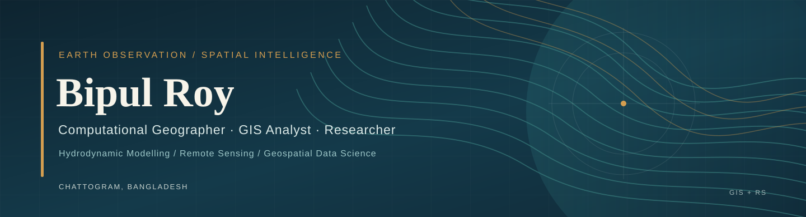

<!-- GitHub profile README | Bipul Roy | @Bipul-roy-AI -->

  

<h1 align="center">Bipul Roy</h1>

<strong>Computational Geographer · GIS Analyst · Geospatial Researcher</strong>

Hydrodynamic Modelling · Earth Observation · Spatial Epidemiology · Environmental Data Science

  <a href="https://bipul-roy-ai.github.io/">Portfolio</a> ·
  <a href="https://www.linkedin.com/in/bipul-roy-635140171/">LinkedIn</a> ·
  <a href="mailto:bipulroyedu@gmail.com">Email</a>

---

## About

I'm a GIS analyst and geospatial researcher in Bangladesh. My work covers hydrodynamic flood modelling, satellite-based environmental monitoring, and the Python, QGIS and Google Earth Engine tools I build to make that work repeatable.

I work remotely as a GIS Analyst at SPEKTER GmbH (Germany), preparing data for coupled 1D/2D drainage and flood models. I'm also a Research Assistant at the Space and Environment Research Center (SERC), Bangladesh, where I study satellite methane monitoring over rice-growing landscapes. Before that I was a Research Consultant at CEGIS, mapping land use and land cover from high-resolution satellite and UAV imagery.

## Research interests

- Compound flooding: tidal-rainfall interaction, urban drainage, 1D/2D model coupling
- Remote sensing: SAR, Sentinel and Landsat time series, surface water, land-cover change
- Wetlands and ecohydrology: soil moisture, methane, flash-flood disturbance, water balance
- Environmental health: air pollution, urban heat, dengue and spatial epidemiology

## Research projects

Each repository says what its results can and cannot support. Most are exploratory and not field-validated.

| Project | What it found or asks | Status |
| :--- | :--- | :--- |
| [Hakaluki Haor wetland and methane](https://github.com/Bipul-roy-AI/Hakaluki-Haor-Wetland-Methane-Research) | 84 months (2019-2025) of Sentinel-1 (214 acquisitions), CHIRPS, ERA5-Land and TROPOMI data. Low-backscatter area follows the monsoon, but a rainfall-based Ridge model did not consistently beat a month-median baseline. TROPOMI methane covers 69 of 84 months and is mostly missing in the wet season. Includes an ESA Biomass P-band pilot (October 2026). | Exploratory analyses complete |
| [CHT soil-moisture gap filling](https://github.com/Bipul-roy-AI/cht-soil-moisture-gapfilling) | Only 7.11% of 248,400 sampled SMAP records passed quality screening. On held-out 2022 records, XGBoost with radar and vegetation predictors reached RMSE 0.0555 m³/m³ against 0.0701 for a calendar-month baseline. The reference is the SMAP product, not field measurements. | Experiment complete, not ground validated |
| [Dhaka air quality and climate](https://github.com/Bipul-roy-AI/Dhaka-Air-Quality-Climate-Research) | 312 monthly records (2000-2025) combining PM2.5, MODIS AOD, Sentinel-5P NO2 and ERA5-Land. The PM2.5 series shifts abruptly around August 2022, when the observation count also changes, so trend results carry that caveat. | Exploratory, provenance review ongoing |
| [Bangladesh crop phenology](https://github.com/Bipul-roy-AI/bangladesh-crop-phenology) | Detects candidate growth cycles from Earth Engine time series and audits the AgriclimateBD crop-calendar data. The first export (Barguna) has been processed. | Prototype, no field validation |
| [SAR flood segmentation](https://github.com/Bipul-roy-AI/Flood_segementation_sar_Bangladesh) | Does pre-event SAR context reduce confusion between existing water and new inundation? Compares water and change rules with a small U-Net on the same splits. | Code and CPU checks done, no Bangladesh results yet |
| [Aerosol-cloud interactions](https://github.com/Bipul-roy-AI/AEROSOL-CLOUD-CLIMATE-INTERACTIONS) | Literature review, dataset catalog and pilot protocol for satellite aerosol-cloud analysis over the northern Bay of Bengal. | Study design, no data analyzed |

## Hydraulic modelling tools

ArcMap 10.8 toolboxes for preparing and checking drainage model inputs.

| Tool | What it does |
| :--- | :--- |
| [MIKE model cross-check](https://github.com/Bipul-roy-AI/DHI_MIKE_m11-mu-m21fm-crosscheck) | Compares pipe and node shapefiles with MIKE 11, MIKE+ and MIKE 21 FM files and writes CSV reports of differing and missing values. Includes batch checking across several M21FM files. |
| [Pipe and culvert mesh tool](https://github.com/Bipul-roy-AI/Pipe-Culvert-Mesh-Tool) | Fills pipe and culvert inflow and outflow levels from mesh polygon elevations. |
| [MU node attribute updater](https://github.com/Bipul-roy-AI/Mike-urban-network-node-updater) | Fills MU node attributes from pipe connectivity, optional DWG survey levels and mesh bathymetry. Backs up the shapefile before editing. |

## Geospatial software

| Tool | What it does |
| :--- | :--- |
| [Universal Satellite](https://github.com/Bipul-roy-AI/Universal-Satellite) | Searches 30 satellite and environmental data sources, downloads assets and computes spectral indices (280 formulas) from QGIS, ArcGIS Pro, Python or Node/TypeScript. |
| [Earth Engine Research Workbench](https://github.com/Bipul-roy-AI/gee_interactive_downloader) | Local Streamlit app that exports GeoTIFFs, CSV time series and JSON method records, with scene IDs and processing settings kept alongside the data. |
| [Sentinel Data Toolbox for QGIS](https://github.com/Bipul-roy-AI/qgis-sentinel-toolbox) | QGIS plugin for searching, downloading and preprocessing Sentinel-1 and Sentinel-2 imagery, using Planetary Computer or Copernicus Data Space. |
| [Watershed Rainfall Analyzer](https://github.com/Bipul-roy-AI/watershed-rainfall-analysis) | Area-weighted basin rainfall statistics with Mann-Kendall, Sen's slope, Pettitt and SPI. Ships with Docker and a citation file. |
| [Land surface temperature mapping](https://github.com/Bipul-roy-AI/Automated-Land-Surface-Temperature-LST-Mapping) | Command-line LST retrieval from Landsat 8/9, MODIS, ECOSTRESS and ASTER, with tests. Downscaling and trend functions are experimental. |
| [Surface water analysis](https://github.com/Bipul-roy-AI/Bangladesh-surface-water-analysis) | Earth Engine monsoon and dry-season surface water extent for Bangladesh, with a mangrove NDVI filter. |
| [Water balance and recharge](https://github.com/Bipul-roy-AI/gee-water-balance-recharge-bangladesh) | Screening-level groundwater recharge for Bangladesh in 2022 from IMERG, MODIS ET and GLDAS. |
| [LULC classification engine](https://github.com/Bipul-roy-AI/gee-lulc-research-engine) | Earth Engine land-cover classification with Random Forest, SVM and CART and server-side K-fold validation. |
| [Topographic soil-moisture controls](https://github.com/Bipul-roy-AI/topographic-soil-moisture-controls) | Spatial cross-validation demo on a synthetic soil-moisture target. |

## Public project

[ShasthoPath](https://bipul-roy-ai.github.io/Health_care_accessibility/) is a free map and directory of healthcare institutions in Bangladesh, in English and Bangla. It draws on the DGHS facility registry (39,442 institutions, of which 28,464 pass a national-boundary check) with routing, helplines and division-level statistics. Source code: [Health_care_accessibility](https://github.com/Bipul-roy-AI/Health_care_accessibility).

## Current work

- Compound tidal-rainfall flooding in Chattogram's khal (canal) system, using 1D/2D hydrodynamic modelling (graduate research)
- Methane over Asian rice-growing landscapes with Sentinel-5P and radar imagery (SERC)
- Compound flooding and salinity in the tidal Halda River
- Dengue risk in Chattogram and its spatial environmental factors

## Experience

| Role | Organization | Focus |
| :--- | :--- | :--- |
| GIS Analyst, Jul 2025 to present | SPEKTER GmbH, Germany (remote) | Coupled 1D/2D hydrodynamic models, municipal drainage and infrastructure mapping |
| Research Assistant, Feb 2025 to present | Space and Environment Research Center (SERC) | Satellite and SAR analysis for rice-field methane research |
| Research Consultant, May 2024 to Jul 2025 | CEGIS, Bangladesh | Satellite and UAV land-cover mapping, ISO LCCS workflows |
| Field Researcher, Feb to Mar 2024 | Shahjalal University of Science & Technology | Air, noise and water-quality assessment at Kuakata Sea Beach |

## Education

- Graduate studies in GIS for Environment and Development, Jahangirnagar University, Bangladesh. Thesis on compound tidal-rainfall flooding in Chattogram's khal system.
- BSc in Geography and Environment, Shahjalal University of Science & Technology, Bangladesh (2024). Thesis on dengue spatial epidemiology in Chattogram.

## Manuscripts and presentations

Listed as manuscripts; no publication or peer-review status is claimed here.

- Decades of Transformation: Quantifying the Effects of Urbanization on the Hydroclimate of Dhaka, Bangladesh (2025)
- Vector-Borne Infectious Diseases of Chattogram City: A Geo-Spatial Investigation on Dengue-Infected Patients and Breeding Sites of Aedes Mosquitoes (2025)

Conference presentations:

- Spatial Dynamics of Environment, Socioeconomics & Public Health in Urban Transport Hubs: A Case Study in Sylhet City Corporation. RURS 1st International Student Conference and Research Fair, 2024.
- Enhancing the Learning Experience: Exploring the Integration of Technology in University Classrooms. BIGM National Conference, 2024.

## Tools

- GIS and Earth observation: ArcGIS Pro, ArcMap, QGIS, Google Earth Engine, Sentinel-1/2, ERDAS IMAGINE, UAV mapping
- Hydraulic modelling: MIKE+, MIKE 11, MIKE 21 FM, MIKE FLOOD, HEC-RAS, Hydro_AS, SMS, EPANET, Civil 3D
- Programming and statistics: Python (pandas, NumPy, GeoPandas, scikit-learn, XGBoost), JavaScript, SQL, R, SPSS

## Community

- GIS instructor at School of Research, teaching spatial analysis and map visualisation
- Rapid flood mapping and vulnerability assessment during the 2024 Feni-Cumilla floods

## Contact

I'm open to collaboration on hydrodynamic modelling, environmental remote sensing, geospatial automation and spatial epidemiology.

[Email](mailto:bipulroyedu@gmail.com) · [LinkedIn](https://www.linkedin.com/in/bipul-roy-635140171/) · [Portfolio](https://bipul-roy-ai.github.io/)
